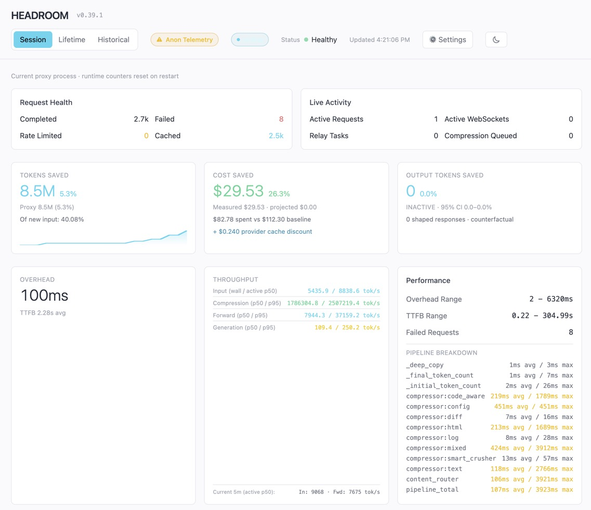

Headroom is a local context-compression layer for AI coding tools. It sits between your coding agent and the model and compresses large tool outputs, logs, file reads, and other context before they reach the LLM. The result is less noise, lower token usage, and often faster responses without changing the underlying code or the answers you get. This is especially helpful in bioinformatics work where sessions can involve large logs, search results, and multi-file analyses.

For more details, see the project homepage at <https://github.com/headroomlabs-ai/headroom> and the official documentation at <https://docs.headroomlabs.ai/docs>.

## Where Headroom runs

Headroom runs on your GFE or laptop in both workflows. Local VS Code connects to it directly; a Remote-SSH session on Biowulf or FRCE reaches the same proxy through SSH port forwarding.

```{mermaid}
flowchart LR
    local["GFE or laptop<br/>VS Code + Copilot"] --> headroom["Headroom on GFE or laptop<br/>127.0.0.1:8788"]
    hpc["Biowulf or FRCE<br/>Remote VS Code + Copilot"] --> hpc_port["HPC localhost:8788"]
    hpc_port -->|SSH RemoteForward| headroom
    headroom --> model["Model provider"]
```

Do not start another Headroom proxy on Biowulf or FRCE.

## Quick start on your MacBook

If you do not have `uv` yet, install it with Homebrew:

```bash
brew install uv
```

Install Headroom, then start the proxy in a dedicated terminal on your Mac:

```bash
uv tool install --python 3.13 "headroom-ai[all]"
headroom proxy --port 8788
```

`headroom proxy` runs in the foreground. Keep this terminal open while you use Headroom. If you stop the command with `Ctrl+C`, close the terminal, log out, or restart your Mac, rerun `headroom proxy --port 8788` before starting your next VS Code session.

Then check the savings dashboard at:

- <http://127.0.0.1:8788/dashboard>
- or run `headroom savings`

Use the dashboard to confirm that the proxy is active and to inspect the estimated token reduction. The proxy uses port 8788 to match the forwarding setup for the Biowulf remote connection.

A working dashboard should show a green **Healthy** status and populate its request, token-savings, throughput, and performance panels as Copilot sends traffic through the proxy. Your values will differ from this example.

{width="90%"}

## Using it with VS Code

This setup uses one Headroom proxy running on your Mac. SSH makes that proxy available to the remote VS Code session at `127.0.0.1:8788` on Biowulf.

Add the following to the `cn*` block in your local `~/.ssh/config`:

```ssh
Host cn*
    RemoteForward 127.0.0.1:8788 127.0.0.1:8788
    ExitOnForwardFailure yes
```

Start the proxy in its dedicated terminal on your Mac before connecting to Biowulf. Then reconnect to the host from VS Code and reload the VS Code window if it was already open so the Copilot settings pick up the proxy configuration. Do not start another Headroom proxy on the compute node; the SSH `RemoteForward` connects the remote port to the proxy already running on your Mac.

For local VS Code editing, use the same Mac proxy directly without SSH forwarding. In both cases, the repository and its files remain unchanged.

## Good fit for CCBR

Headroom is a good choice when you are running long AI-assisted coding sessions, reading large log files, or exploring large codebases. It is not a replacement for good prompt design or careful validation, but it is a useful way to keep Copilot and other agent workflows efficient and cost-aware.
