## {}

:::{.column width="10%"}
:::

:::{.column width="80%"}
::::{.callout-important .xx-large-text}
This presentation was created before the directive to use the term "Super Intelligence (SI)" in place of "Artificial Intelligence (AI)".

Always refer to the official [**NIH AI Hub**](https://nih.sharepoint.com/sites/NIH-ai/SitePages/Responsible-AI.aspx) for the most up-to-date policy information.
::::
:::

::: footer
<https://nih.sharepoint.com/sites/NIH-ai/SitePages/Responsible-AI.aspx>
:::

## Goals for this talk

- Provide background information on AI for Bioinformatics.
- Cover the NIH Responsible AI Policy.
- Equip you with practical tips for minimizing the risks of using LLMs & agents for bioinformatics.

:::{.column width="15%"}
:::

:::{.callout-tip .column width="70%" .xx-large-text .fragment}
### Take-home message

By the end, you should feel empowered with the knowledge to
**use agentic LLMs proficiently** for bioinformatics,
without compromising the **quality of your science**.

:::

## Bioinformatics is central to biomedical research

:::{.align-center}
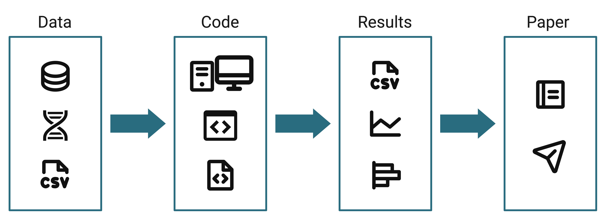{width="80%"}
:::

Audience roles: bioinformatician, computational biologist, data analyst, research software engineer -- **anyone who writes code to analyze biological data**.

## Academic Definition of Generative AI {}

:::{.align-center}
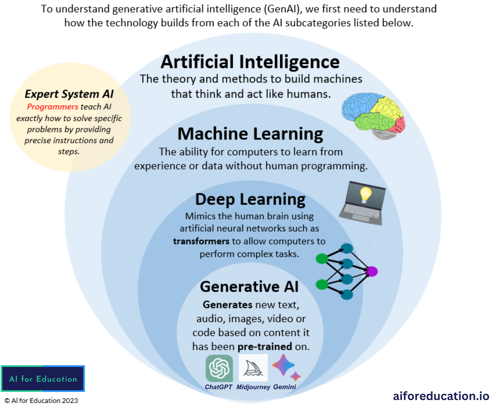{width="71%"}
:::

::: footer
Image: <https://www.aiforeducation.io/ai-resources/generative-ai-explainer>
:::

## Agentic LLMs have transformed software development {.x-large-text}

:::{.align-center}
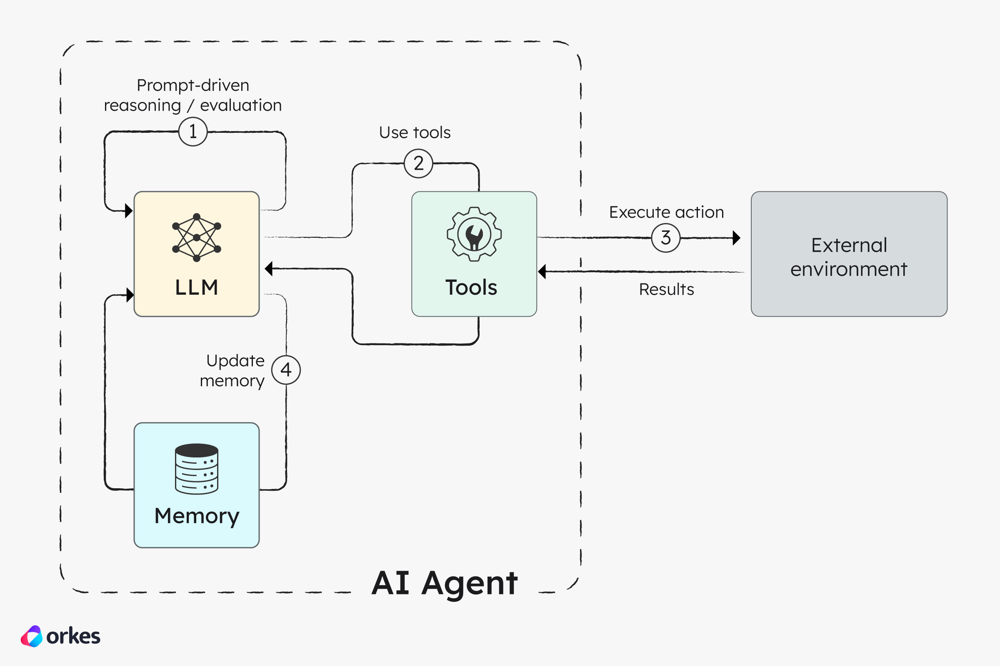{width="90%"}
:::

::: footer
Image: <https://orkes.io/blog/agentic-ai-explained-agents-vs-workflows>
:::

## Agentic LLMs can accelerate bioinformatics

:::{.align-center}
{width="80%"}
:::

:::: {.columns }

::: {.column width="45%" .medium-text}
> ### We can write code faster than ever before
>
> generate new code, troubleshoot bugs, search the web, write tests, execute code
:::

:::{.column width="5%"}
:::

:::{.column width="45%" .medium-text .fragment}
> ### We can write _bad_ code faster, too
>
> unreproducible work, incorrect methods, bugs, inefficiencies, unreadable code, lack of transparency, security vulnerabilities, malware, destructive agent actions
:::

::::

## NIH Responsible AI Policy

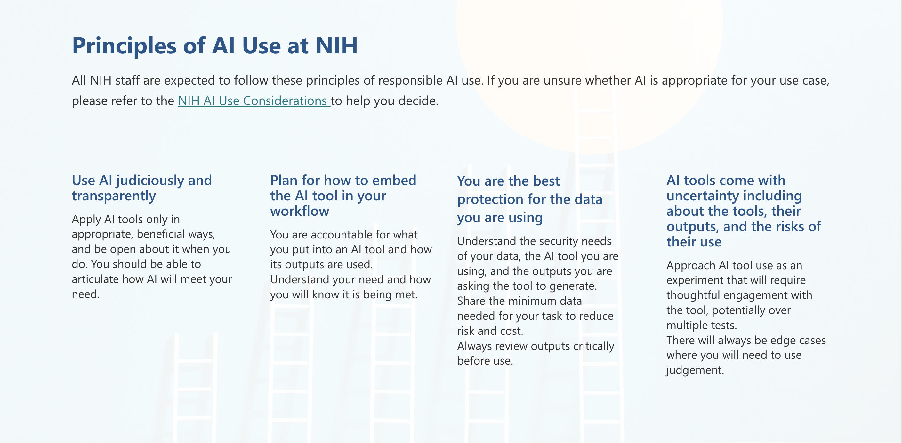{width="120%"}

::: footer
Content retrieved September 2026 from the [NIH Responsible AI site](https://nih.sharepoint.com/sites/NIH-ai/SitePages/Responsible-AI.aspx). Please refer to the official site for the latest guidance.
:::

## NIH AI Use Checklist

::::: {.columns .x-large-text}

:::: {.column width="47%" }

:::{.callout-warning .fragment}
### Stop and Reconsider If:
- You cannot verify the output
- You cannot explain or justify the result
- The task involves high-stakes decisions without expert review
:::

:::{.callout-note icon=false .fragment}
### 1. Confirm the Use is Appropriate
- Can you clearly state what you need, your audience (e.g., internal, external), and why AI helps?
- Do you have the time and expertise to review and adapt the output?
- Are you using a federally approved or authorized tool?
:::

:::{.callout-note icon=false .fragment}
### 2. Define the Human-AI Roles
- What task is the AI performing (e.g., drafting, summarizing, classifying)?
- What decisions will you make (vs. the AI)?
- Are you prepared to be accountable for how outputs are used?
:::

::::

::::{.column width="3%"}
::::

:::: {.column width="47%"}

:::{.callout-note icon=false .fragment}
### 3. Project Data and Outputs
- Does your input data include clinical, sensitive, identifiable, or restricted information?
- Is that data allowed in the tool you are using (e.g., consistent with consent, IRB decision, agreements)?
- Are you sharing only the minimum data necessary?
- Do the outputs create new sensitivity, intellectual property, or reuse risks?
:::

:::{.callout-note icon=false .fragment}
### 4. Verify Outputs
- Have you checked the facts, numbers, and citations?
- Have you tested outputs for errors, bias, or omissions?
- Would you be comfortable defending this output if questioned?
:::

:::{.callout-note icon=false .fragment}
### 5. Be Transparent About AI Use
- Will others know AI was used?
- Have you documented how outputs were generated (e.g., prompts used)?
- Have you avoided presenting AI output as authoritative without review?
:::

::::

:::::

::: footer
Content retrieved September 2026 from the
[NIH AI Use Checklist](https://nih.sharepoint.com/sites/NIH-ai/SitePages/NIH-AI-Use-Checklist.aspx).
Please refer to the official site for the latest guidance.
:::

## Human in the loop

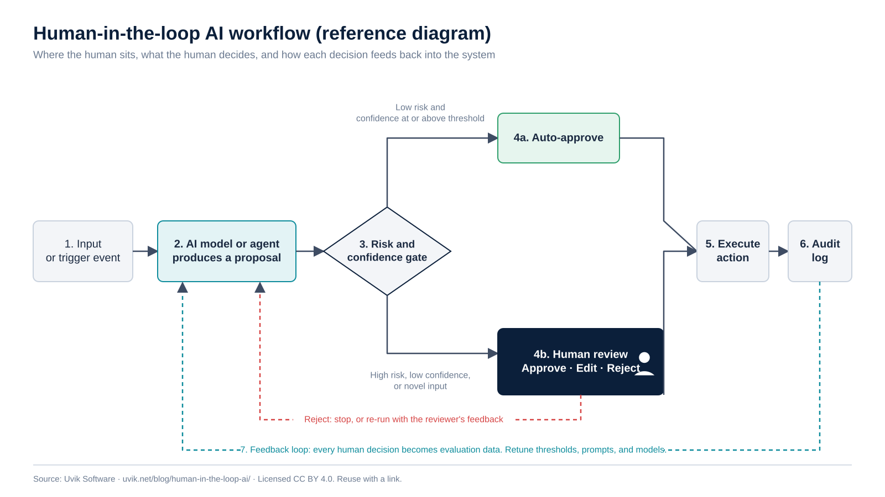

::: footer
Image: <https://uvik.net/blog/human-in-the-loop-ai/>
:::

## Human ~~in~~ driving the loop

::: {.align-center}

:::: {.x-large-text}
A better way: humans judiciously use agents when appropriate to **support** human-driven tasks.
::::

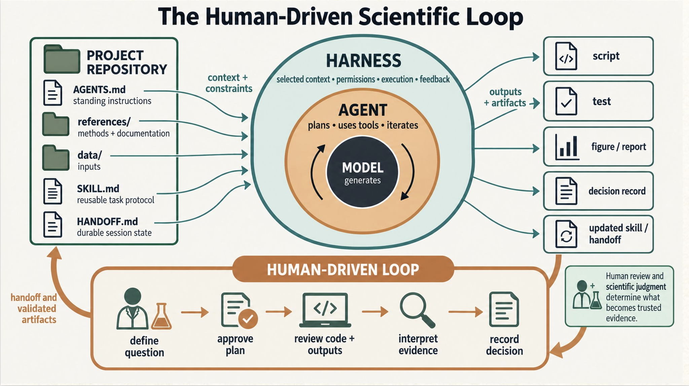

:::

::: footer
Image credit: [Samarth Mathur](https://bioinformatics.ccr.cancer.gov/btep/classes/from-scripts-to-skills-using-generative-ai-without-losing-scientific-control)
:::

## Bioinformaticians design, develop, and execute code {.x-large-text}

:::{.callout-note icon=false .column width="30%" .xx-large-text .fragment}
### Design

:::: {.align-center}
 &nbsp; 
:::

- Read scientific papers, software documentation, and forums.
- Plan how to analyze data to answer a scientific question.
- Decide how new code will accomplish the analysis plan.
:::

:::{.column width="5%"}
:::

:::{.callout-note icon=false .column width="30%" .xx-large-text .fragment}
### Develop

:::: {.align-center}
 &nbsp; 
::::

- Write new scripts, packages, and command line tools to accomplish the analysis plan.
- Write tests to validate the code performs as expected.
- Document how the code works and how it is used to produce results.
:::

:::{.column width="5%"}
:::

:::{.callout-note icon=false .column width="30%" .xx-large-text .fragment}
### Execute

:::: {.align-center}
 &nbsp; 
::::

- Obtain the data from the study/experiment.
- Install necessary software dependencies.
- Run the code on the data and evaluate the results.
:::

::: {.fragment .align-center}

&nbsp;

#### _How can agents assist us in bioinformatics tasks?_

Treat agents like just another tool in your toolbox.
:::

## Practical tips for responsible agent use

:::{.column width="10%"}
:::

::::{.column width="65%" .xxx-large-text }

:::{.callout-tip icon=false}
###  &nbsp; Follow reproducible practices
:::

:::{.callout-tip icon=false}
###  &nbsp; Review, test, and validate all code
:::

:::{.callout-tip icon=false}
###  &nbsp; Document everything
:::

::::

## Reproducibility is essential for science  {background-gradient="radial-gradient( #A6C7C9, #FFFFFF)"}

:::{.filled-box .align-center}
Yourself ➡️ Future you ➡️ Your collaborators ➡️ Peers in your field
:::

:::{.fragment}
- Can each of the above people run your code on the same dataset and get the same results?
- How difficult would it be for each of them to reproduce your results?
:::

:::{.fragment .align-center}
**You are your own most important collaborator**
:::

## Reproducible practices for responsible AI use 

::: {.column}
#### Organize your projects

- One project per directory.
- Keep data, code, and outputs in separate subdirectories.
- Data is read-only; outputs should only be written by the code.

:::

::: {.column}

```{.default filename="file system tree" code-line-numbers=false}
/data/$USER/projects
├── my-rnaseq-project
│   ├── AGENTS.md
│   ├── data/
│   ├── docs/
│   ├── README.md
│   ├── results/
│   ├── scripts/
│   └── tests/
└── r-dataviz-explorer
    ├── references/
    ├── scripts/
    ├── SKILL.md
    └── tests/
```

:::

::: footer
Credit to Samarth Mathur for these project examples.
:::

## Reproducible practices for responsible AI use 

::: {.column}
#### Organize your projects

- One project per directory.
- Keep data, code, and outputs in separate subdirectories.
- Data is read-only; outputs should only be written by the code.

#### Version control & backup with git & GitHub

- Create a git repository for each project and upload it to GitHub.
- Commit meaningful code changes and sync with GitHub frequently.
:::

::: {.column}
```{.default filename="file system tree" code-line-numbers=false}
/data/$USER/projects
├── my-rnaseq-project
│   ├── AGENTS.md
│   ├── data/
│   ├── docs/
│   ├── README.md
│   ├── results/
│   ├── scripts/
│   └── tests/
└── r-dataviz-explorer
    ├── references/
    ├── scripts/
    ├── SKILL.md
    └── tests/
```

:::

::: footer
Credit to Samarth Mathur for these project examples.
:::
## Reproducible practices for responsible AI use 

::: {.column}
#### Organize your projects

- One project per directory.
- Keep data, code, and outputs in separate subdirectories.
- Data is read-only; outputs should only be written by the code.

#### Version control & backup with git & GitHub

- Create a git repository for each project and upload it to GitHub.
- Commit meaningful code changes and sync with GitHub frequently.
:::

::: {.column .align-right}

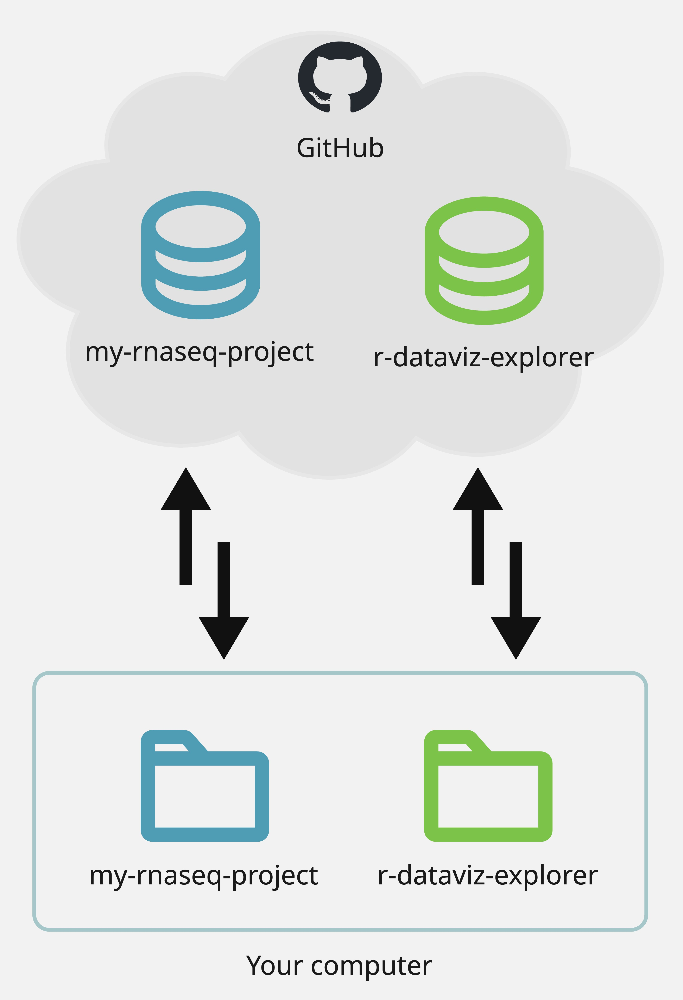{width="75%"}

:::

::: footer
Credit to Samarth Mathur for these project examples.
:::

## Review, test, and validate 

From the NIH Responsible AI policy:

> Do not rely on the technology to be a software developer by proxy:
>
> - All well-written code must adhere to security design and ethical principles.
> - All code output needs to be reviewed for completeness, quality, efficiency, and, most of all, security.
> - Leverage manual and automated validation tools and testing technologies to help ensure these factors.
> - If you cannot identify or understand what a piece of AI generated code does, you should not use it.

_AI outputs may be incomplete, inaccurate, biased, or fabricated._

::: footer
Content retrieved September 2026 from the
[NIH Responsible AI site](https://nih.sharepoint.com/sites/NIH-ai/SitePages/Responsible-AI.aspx).
Please refer to the official site for the latest guidance.
:::

## Review 

- Read the entire output of each prompt and ensure you understand it.
- Be skeptical. Do not blindly trust that the output is complete or correct.
- Treat agents as untrustworthy, in terms of both inputs and outputs.
  - Do not expose passwords, access tokens, or sensitive information.
  - Refer to the [NIH Responsible AI page - approved tools and data types](https://nih.sharepoint.com/sites/NIH-ai/SitePages/Responsible-AI.aspx#approved-tools-and-data-types) for which types of data can be used with the tools we have access to.

::: footer
Please refer to the official [NIH Responsible AI site](https://nih.sharepoint.com/sites/NIH-ai/SitePages/Responsible-AI.aspx#approved-tools-and-data-types) for the latest guidance.
:::

## Review 

:::{.column}
> If you cannot identify or understand what a piece of AI generated code does, you should not use it.

:::: {.small-text}
Content retrieved September 2026 from the [NIH Responsible AI site](https://nih.sharepoint.com/sites/NIH-ai/SitePages/Responsible-AI.aspx). Please refer to the official site for the latest guidance.
::::

:::

:::{.column .fragment .callout-tip title="Challenge yourself!" .xx-large-text}
If you do not understand a piece of AI-generated code, dig into the documentation and tutorials to **learn how it works**.
:::

::::{.x-large-text}
:::{.fragment}
- Come across a **package or function** you've never seen? Find the documentation and learn how it works!
  - R: use `?` and `help()`. Python: use `help()`
  - Docs websites: <https://rdrr.io/>, <https://docspython.org/3/>
:::

:::{.fragment}
- Come across a **large chunk of code** with many patterns you don't understand?
  - Prompt the agent to explain it line-by-line. Verify the explanation by asking for sources and reading them.
:::

:::{.fragment}
- Use forums for in-depth help from people.
  - StackOverflow, biostars, Posit forum, GitHub discussions, your colleagues.
:::
::::

## Testing & validation 

Write tests to make sure the code behaves as expected.

- Unit tests for individual functions on trivial inputs/data.
- Integration tests run multiple functions or even an entire analysis on small & simulated datasets.
- R: `testthat`. Python: `pytest`, `unittest`

:::{.column width="35%"}
```{.default filename="file system tree" code-line-numbers=false}
my-python-project
├── data/
├── src/mypackage
│   └── main.py
└── tests
    └── test_main.py
```
:::

:::{.column width="5%"}
:::

:::{.column width="58%" .xx-large-text .fragment}
```{.python filename="src/mypackage/main.py"}
def gc_content(seq):
    """Fraction of G/C bases in a DNA sequence."""
    seq = seq.upper()
    return (seq.count("G") + seq.count("C")) / len(seq)
```

```{.python filename="tests/test_main.py"}
from mypackage.main import gc_content

def test_gc_content():
    assert gc_content("GGCC") == 1.0
    assert gc_content("ATAT") == 0.0
    assert gc_content("atgc") == 0.5
```
:::

## Testing & validation 

:::{.column width="48%" .align-center}
Run tests before accepting code.

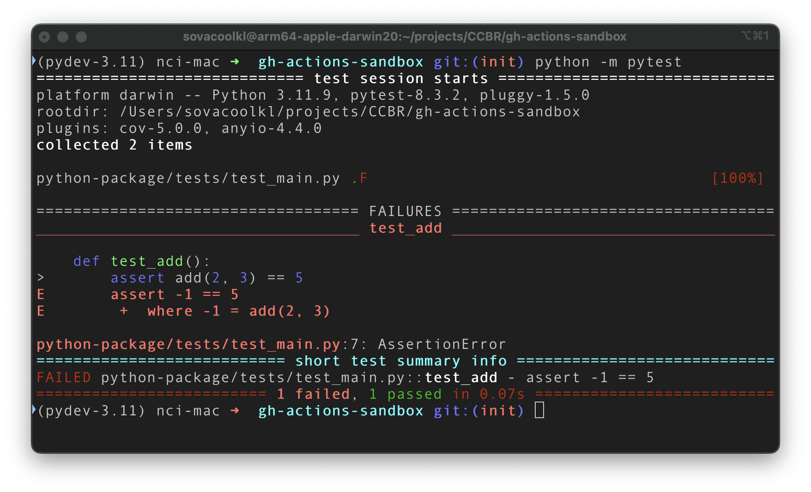{width="100%"}

:::

:::{.column width="3%"}
:::

:::{.column width="48%" .align-center .fragment}
Use GitHub actions to automate.

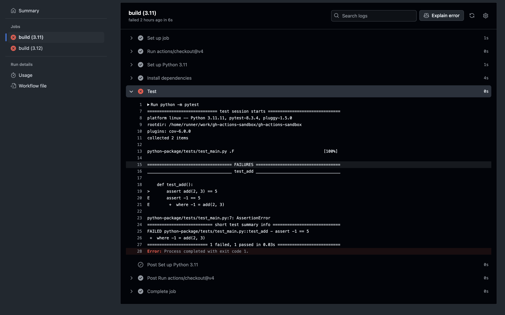{width="100%"}

:::

## Testing & validation 

:::{.column width="47%"}
Use linters and code quality checks.

- Ensure code is formatted for readability, quality, and syntax is correct.
- Security and vulnerability scanning with GitHub Advanced Security.
- R: `air`. Python: `ruff`.
:::

:::{.column width="3%"}
:::

:::{.column width="49%" .fragment}
Use `pre-commit` to run checks automatically on every change.

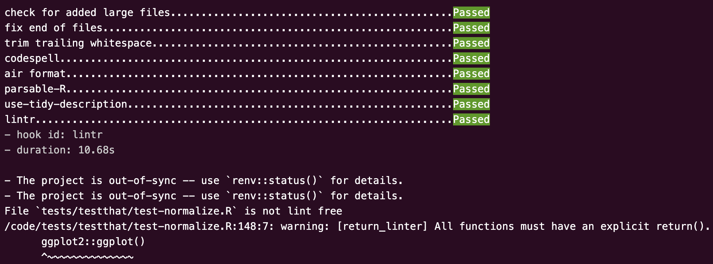{width="100%"}
:::


## Document everything 

Inline comments, function docstrings, vignettes, tutorials, getting started guide

:::{.column width="45%"}
```{.r filename="Rscript"}
#' Add together two numbers
#'
#' @param x A number
#' @param y A number
#' @returns The sum of `x` and `y`
#' @examples
#' add(1, 1)
#' add(10, 1)
add <- function(x, y) {
  x + y
}
```

:::: fragment
:::{.align-center}
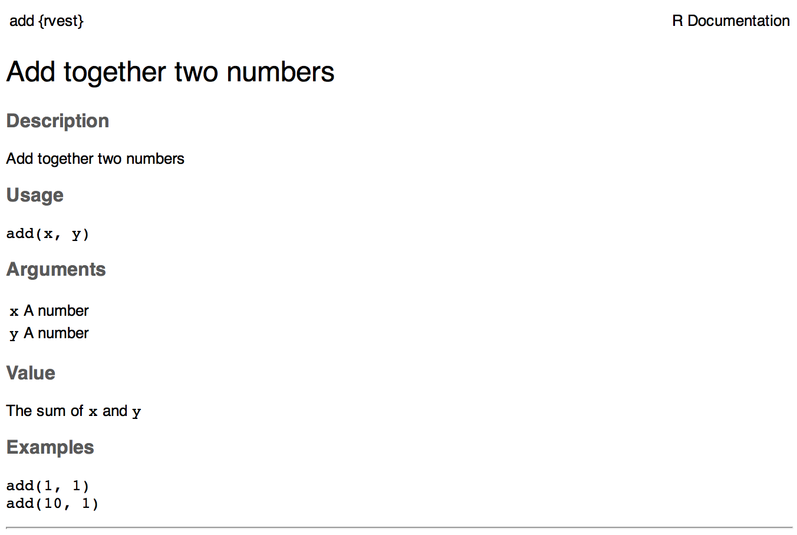
:::
::::

:::

:::{.column width="3%"}
:::

:::{.column width="52%"}
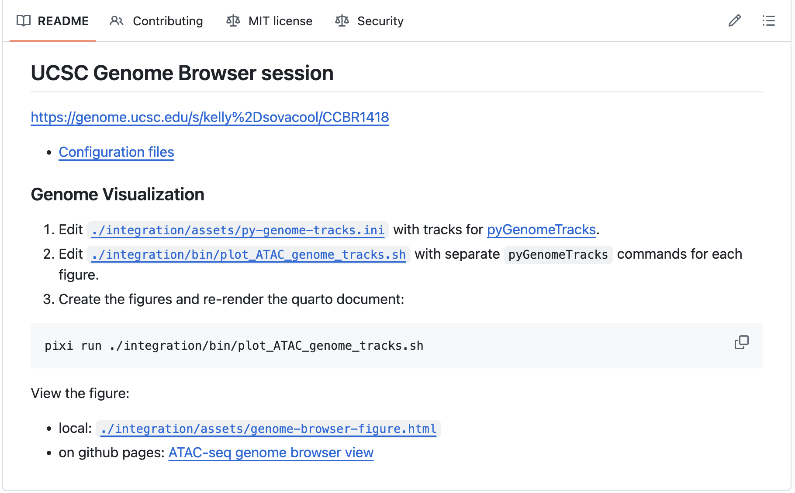{.fragment .align-center}
:::

::: footer
:::

## Document how you are using agents  {.x-large-text}

_from the very beginning of the project:_

::: {.column width="48%"}

Create a document outlining how you will and will _not_ use LLMs and agents.

```{.default filename="docs/ai-usage.md" code-line-numbers=false .medium-text}
- Human responsibilities: Formulate the problem
  statement, design the software,
  validate the results, write the interpretation.
- Agent roles: assist in generating code,
  unit tests, and function documentation.
```

:::

::: {.column width="4%"}
:::

::: {.column width="48%" .fragment}

Disclose use of LLMs and agents in commit messages, issue comments, and pull requests.

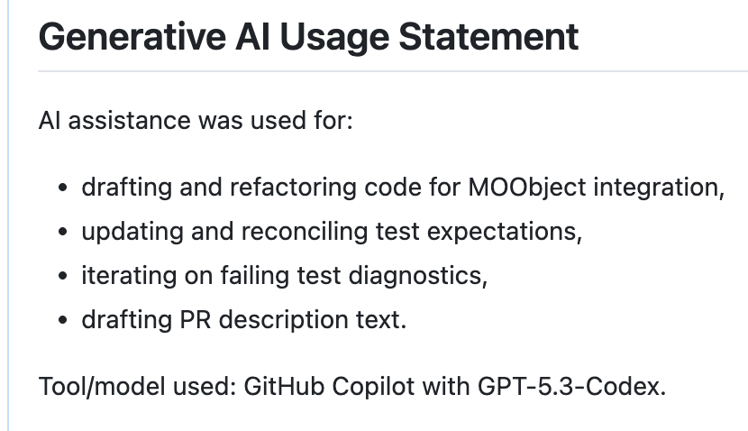

:::

## Responsible agent use to minimize risks {.x-large-text}

&nbsp;

|  | Practice | Risks minimized   |
|--|----------|-------------------|
|  | Follow reproducible practices       | unreproducible work, destructive agent actions |
|  | Review, test, and validate all code | incorrect methods, bugs, inefficiencies, malware |
|  | Document everything                 | unreadable code, unusable code, lack of transparency |

## A checklist for agent-assisted Bioinformatics

::::{.column width="47%"}
:::{.callout-note icon=false}
### Check off every item in this checklist before you trust LLM-generated code
:::

:::{.callout-note icon=false}
### 1. Understand
- [ ] Can I explain what the code is doing?
- [ ] Did I review all functions, parameters, and methods?
:::

:::{.callout-note icon=false}
### 2. Test
- [ ] Did I run it on a small or known dataset?
- [ ] Did I test edge cases and check expected outputs?
- [ ] Have I set up an automated testing framework (pytest, testthat, GitHub Actions)?
:::
::::

::::{.column width="3%"}
::::

::::{.column width="47%"}
:::{.callout-note icon=false}
### 3. Sanity check
- [ ] Do the results make biological sense?
- [ ] Did I check for silent problems: missing samples/genes, genome build, coordinates, strandedness, IDs?
:::

:::{.callout-note icon=false}
### 4. Make it reproducible
- [ ] Are code, parameters, software versions/environment, and inputs captured?
- [ ] Is the validated code committed & synced with GitHub?
:::

:::{.callout-note icon=false}
### 5. Own it
- [ ] Am I comfortable putting my name on this analysis?
- [ ] Have I documented AI use where appropriate?
:::
::::

::: footer
Checklist credit: Vishal Koparde
:::

## Final reminders

:::{.column width="12%"}
:::

::::{.column width="67%"}
:::{.callout-warning icon=false}
### LLMs produce outputs that _look like_ a plausible response to a prompt 🦜

- View these models as another tool in your toolbox alongside IDEs, HPCs, and other software.
- Interpreting the meaning of the generated outputs is your responsibility. Treat it as a learning experience!
:::
:::{.callout-warning icon=false}
### Agentic tools can accelerate bioinformatics 🚀

- Just make sure you're facing the direction you want to go!
:::
::::

## AI Use Statement

- **Human roles**: all text content was written by the author and reviewed by colleagues.
- **Generative AI use**: Copilot was used for reformatting and syntax lookup while drafting this presentation.
- **Images**: image sources are noted on the slides where they appear; images created by others may or may not have used GenAI for assistance. Images listed without a source were created by the author, without GenAI.

## Resources {.x-large-text}

- [NIH Guidelines for Responsible AI](https://nih.sharepoint.com/sites/NIH-ai/SitePages/Responsible-AI.aspx)
- [BTEP Coding Club](https://bioinformatics.ccr.cancer.gov/docs/btep-coding-club)
- [NIH Library](https://www.nihlibrary.nih.gov/)
- Related talks:
  - [Practical introduction to GenAI](https://bioinformatics.ccr.cancer.gov/btep/classes/a-practical-introduction-to-generative-ai-for-bioinformatics) - BTEP
  - [From Scripts to Skills: Using Generative AI Without Losing Scientific Control](https://bioinformatics.ccr.cancer.gov/btep/classes/from-scripts-to-skills-using-generative-ai-without-losing-scientific-control) - BTEP
  - [Organizing and documenting NGS pipelines on GitHub](https://bioinfo-abcc.ncifcrf.gov/training/event/organizing-and-documenting-ngs-pipelines-on-github-building-549-executive-board-room-nci-frederick-1204241200) - ABCS Programmer's Corner
- Tutorial: [GitHub Copilot in VS Code](https://ccbr.github.io/HowTos/docs/generative-AI/gh-pilot-vs-code/)
- [GitHub Copilot in VS Code cheat sheet](https://code.visualstudio.com/docs/copilot/reference/copilot-vscode-features)
