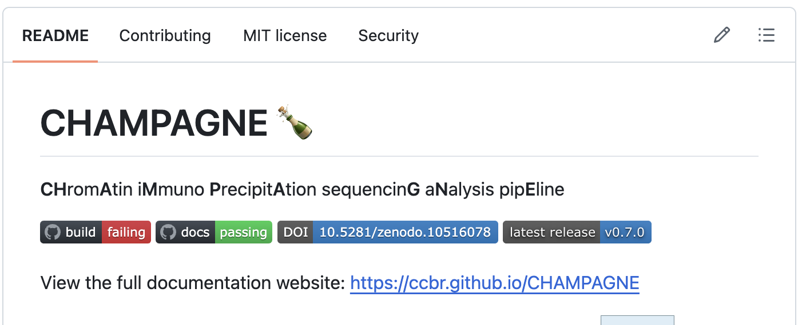
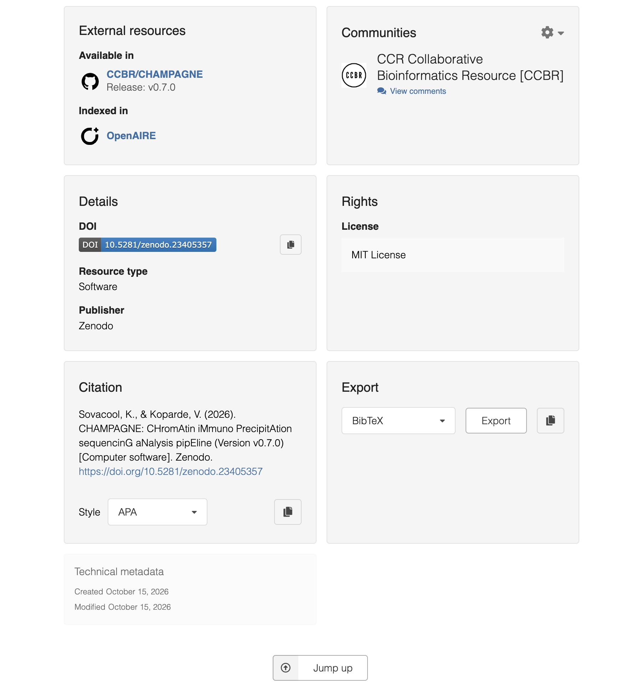

When your analysis uses a CCBR pipeline, tool, or analysis repository, cite it
in your manuscript. Name the software and the version you used in the Methods,
then include its full citation and DOI in the References.

## What to include

For each CCBR resource:

1. In Methods, give its name, exact version, and a citation marker.
2. In References, include the authors, year, title, version, software type,
   archive (usually Zenodo), and DOI.
3. Cite the scientific methods and third-party software you used separately.
4. If you share analysis code in a repository, cite that repository too.

The version in Methods should match the version in the reference. Cite the
specific release DOI when available, rather than a DOI for a different version.
If the version is not known, use the all-versions DOI.
Check the title, author list, version, and DOI against the software's archive
record before submitting your manuscript.

### Example

For example, in the methods section:

> Bulk RNA-seq data were processed with RENEE v2.7.7 (1), and differential
> expression analysis was performed with MOSuite v0.5.0 (2) using limma-voom
> (3, 4). Analysis code is available in a GitHub repository archived in Zenodo (5).

The corresponding references might look like this:

1. Sevilla, S., Sovacool, K., Kuhn, S., Tandon, M., & Koparde, V. (2026).
   *RENEE: Rna sEquencing aNalysis pipElinE* (Version v2.7.7)
   [Computer software]. Zenodo. <https://doi.org/10.5281/zenodo.21074664>
2. Sovacool, K., Homan, P., Koparde, V., & Chill, S. (2026). *MOSuite: R
   package for differential multi-omics analysis* (Version v0.5.0)
   [Computer software]. Zenodo. <https://doi.org/10.5281/zenodo.22262260>
3. Add the appropriate reference for limma.
4. Add the appropriate reference for voom.
5. Nathan, W. (2026). *CCBR/hTLX3_mutIL7R_leukemia_Rodrigues 1.0.0*
   (Version v1.0.0) [Computer software]. Zenodo.
   <https://doi.org/10.5281/zenodo.24093943>

## Find the citation

Get the citation metadata to import into your [reference manager](#reference-management-software).
Use whichever source is available for the software:

### Zenodo record

Follow the DOI badge from the GitHub repository to its Zenodo record.



At the bottom of the record, select **Export** and choose BibTeX or another
format supported by your citation manager.
The [Zenodo guide](zenodo.qmd) explains how CCBR repositories are archived
there.



Include the DOI in the reference as a link, for example
`https://doi.org/10.5281/zenodo.21074664`, or as `doi:10.5281/zenodo.21074664`.
Prefer the DOI for the exact release you used; a general project page or
GitHub URL is not a substitute when a release DOI is available.

### GitHub citation button

On the software's GitHub repository, select **Cite this repository** (in the
About panel) to view citation formats.
This is available when the repository has a `CITATION.cff` file.
Check whether the citation points to the exact release or only to the project in
general.


### Command-line citation option

Some CCBR pipelines and tools provide a `--citation` option or a `cite` command.
Run it as documented by the software; for example:

```sh
champagne --citation
```
```
@misc{YourReferenceHere,
author = {Sovacool, Kelly and Koparde, Vishal},
doi = {10.5281/zenodo.10516078},
month = {10},
title = {CHAMPAGNE: CHromAtin iMmuno PrecipitAtion sequencinG aNalysis pipEline},
url = {https://ccbr.github.io/CHAMPAGNE/},
year = {2026}
}
```

The command exports BibTeX, so save the output to a `.bib` file and import it
into your [reference manager](#reference-management-software).
Check that the exported version matches the version you used and that the DOI is
present.

## Cite an analysis repository

If you wrote analysis code for the paper, upload the code its own GitHub
repository and cite it as a separate software reference.
See [reference 5 above](#example) for an example.

If the analysis repository does not yet have a DOI or you are unsure how to cite it,
[contact Kelly](#getting-help) before submitting the manuscript.

## Reference management software

We recommend using reference management software such as
[Zotero](https://www.zotero.org/)
to organize the papers you cite and format the references in the manuscript.
Zotero is open source and has excellent tools to integrate with your Word
processor of choice or export bibliographies for use with LaTeX and Quarto.
See the Zotero documentation for details: <https://www.zotero.org/support/>

## Getting help

Contact Kelly ([kelly.sovacool@nih.gov](mailto:kelly.sovacool@nih.gov)) if you
have any questions or run into any problems!