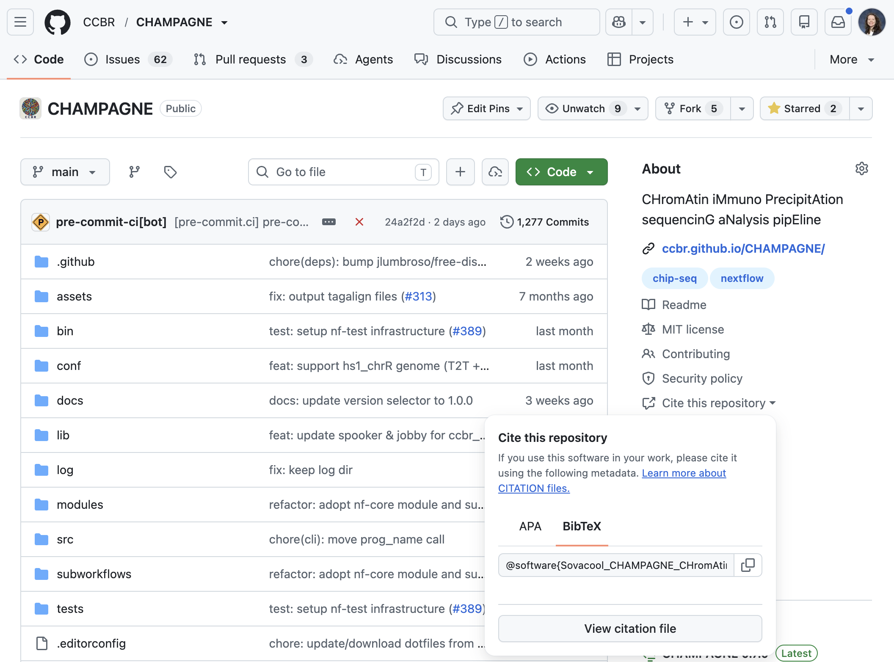

If your analysis uses a CCBR pipeline, tool, or analysis repository, cite it in
your manuscript.
In the Methods section, name the software and give the exact version you used.
In the References section, include its full citation and DOI.

## How to write the manuscript

1. In Methods, name each CCBR software, give the exact version you used,
   and add a citation marker that points to its References entry.
2. In References, include the authors, year, title, version, archive or
  repository URL, and **DOI**.
3. Cite the software separately from papers describing its scientific methods
   and from third-party tools.
4. If you publish analysis code in a separate repository, cite it separately.

The version in Methods must match the version in the reference.
Use the DOI for that specific release when one is available.
If you do not know the version, first try to find it in your run logs or other
analysis records.
If you cannot, use the all-versions DOI and state that the version is unknown.
Before submitting, check the title, author list, version, and DOI against the
software's archive record.

### Example

For example, in the Methods section:

> Bulk RNA-seq data were processed with RENEE v2.7.7 (1), and differential
> expression analysis was performed with MOSuite v0.5.0 (2) using limma and
> voom (3, 4). The analysis code is available in a GitHub repository archived
> in Zenodo (5).

The corresponding references might look like this:

1. Sevilla, S., Sovacool, K., Kuhn, S., Tandon, M., & Koparde, V. (2026).
   *RENEE: Rna sEquencing aNalysis pipElinE* (Version v2.7.7)
   [Computer software]. Zenodo. <https://doi.org/10.5281/zenodo.21074664>
2. Sovacool, K., Homan, P., Koparde, V., & Chill, S. (2026). *MOSuite: R
   package for differential multi-omics analysis* (Version v0.5.0)
   [Computer software]. Zenodo. <https://doi.org/10.5281/zenodo.22262260>
3. [Add the appropriate reference for limma.]
4. [Add the appropriate reference for voom.]
5. Nathan, W. (2026).
   *CCBR/hTLX3\_mutIL7R\_leukemia\_Rodrigues 1.0.0*
   (Version v1.0.0) [Computer software]. Zenodo.
   <https://doi.org/10.5281/zenodo.24093943>

These example references are numbered 1-5, but in a real manuscript they will
usually have different numbers.
We recommend using a [reference manager](#reference-management-software) instead
of numbering and formatting references by hand.
Different journals have their own preferred references style, so the formatting
will vary.

## Find the software citation

Get the citation metadata to import into your [reference manager](#reference-management-software).
Use whichever source is available for the software:

### Zenodo record

Follow the DOI badge from the GitHub repository to its Zenodo record.


At the bottom of the record, select **Export** and choose BibTeX or another
format supported by your reference manager.
The [Zenodo guide](zenodo.qmd) explains how CCBR repositories are archived
there.


Include the DOI in the reference as a link, such as
`https://doi.org/10.5281/zenodo.21074664`, or in the format
`doi:10.5281/zenodo.21074664`.
Use the DOI for the exact release you used; a project page or GitHub URL is not
a substitute when a release DOI is available.

### GitHub citation button

On the software's GitHub repository, select **Cite this repository** in the
About panel to view citation formats.
This option is available when the repository has a `CITATION.cff` file.
Check whether the citation points to the exact release or to the project in
general.



### Command-line citation option

Some CCBR pipelines and tools provide a `--citation` option or a `cite` command.
Run it as documented by the software. For example:

```sh
champagne --citation
```
```bibtex
@misc{YourReferenceHere,
author = {Sovacool, Kelly and Koparde, Vishal},
doi = {10.5281/zenodo.10516078},
month = {10},
title = {CHAMPAGNE: CHromAtin iMmuno PrecipitAtion sequencinG aNalysis pipEline},
url = {https://ccbr.github.io/CHAMPAGNE/},
year = {2026}
}
```

The command exports BibTeX. Save the output to a `.bib` file and import it into
your [reference manager](#reference-management-software).
This example does not include a version, so check the archive record and report
the exact version you used in Methods.
Also check whether the DOI identifies that specific release or all versions.

## Cite an analysis repository

If you wrote analysis code for the manuscript, publish it in a separate GitHub
repository and cite it as a separate software reference.
See [reference 5 above](#example) for an example.

If the analysis repository does not yet have a DOI, or you are unsure how to
cite it, [contact Kelly](#getting-help) before submitting the manuscript.

## Reference management software

We recommend using reference management software, such as
[Zotero](https://www.zotero.org/), to organize your references and format your
bibliography.
Zotero is open source, works with MS Word, and exports bibliographies
for LaTeX and Quarto.
See the [Zotero documentation](https://www.zotero.org/support/) for more
information.

If you are not the first author, chances are someone else is responsible for
preparing the references and formatting the manuscript.
Send them the verified citation information for all CCBR software used.
Before submission, check that each software citation includes the correct
version and DOI, as described in 
[How to write the manuscript](#how-to-write-the-manuscript).
Do not approve a manuscript for submission until the software citations are
included correctly with DOIs.

## Getting help

Contact Kelly ([kelly.sovacool@nih.gov](mailto:kelly.sovacool@nih.gov)) with
questions or if you run into any problems.

## Learning more

For more information on why software citation matters, read the
[FORCE11 Software Citation Principles](https://force11.org/info/software-citation-principles-published-2016/).